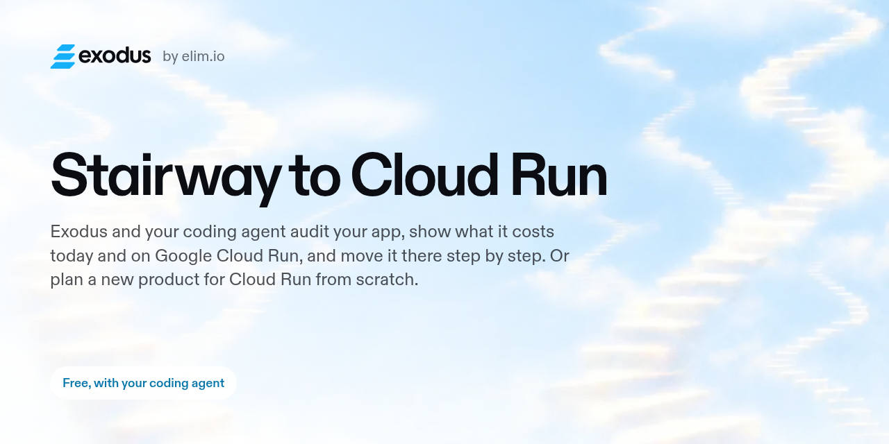
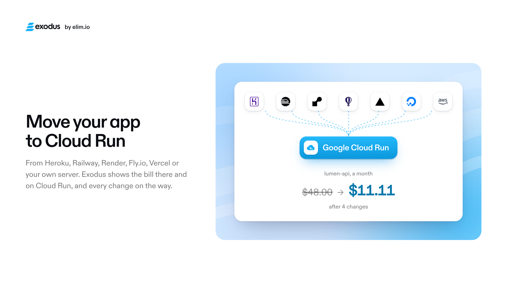
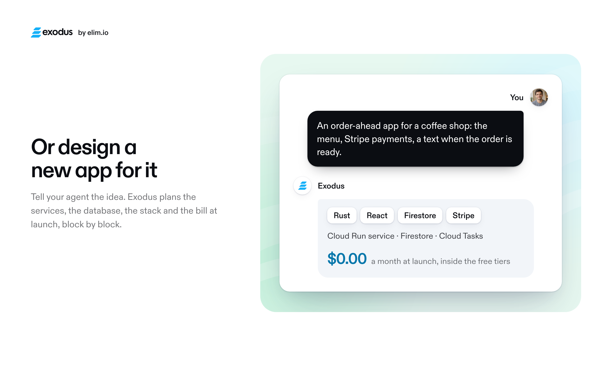
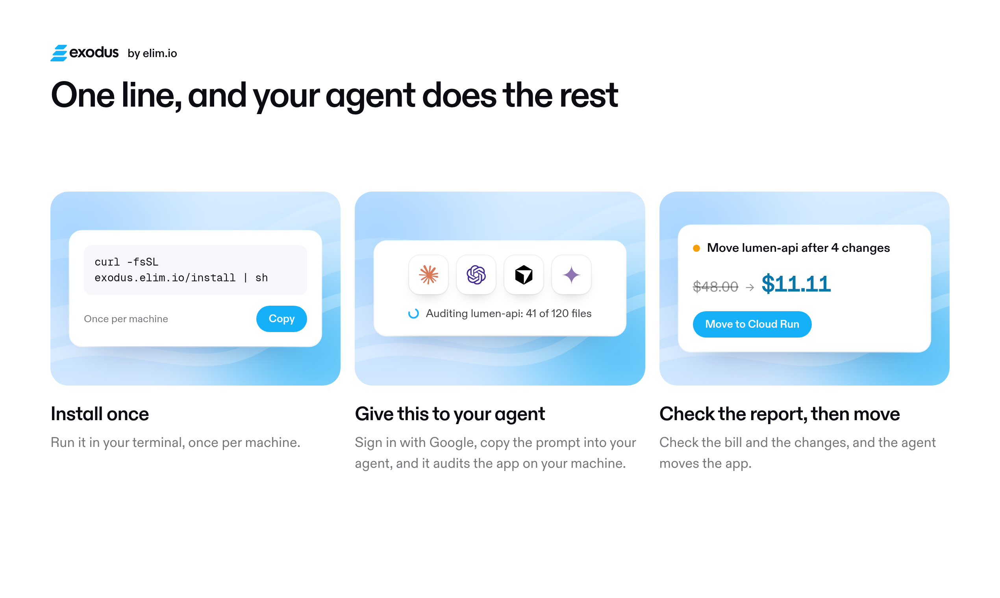
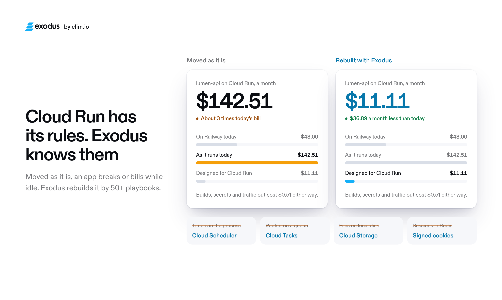
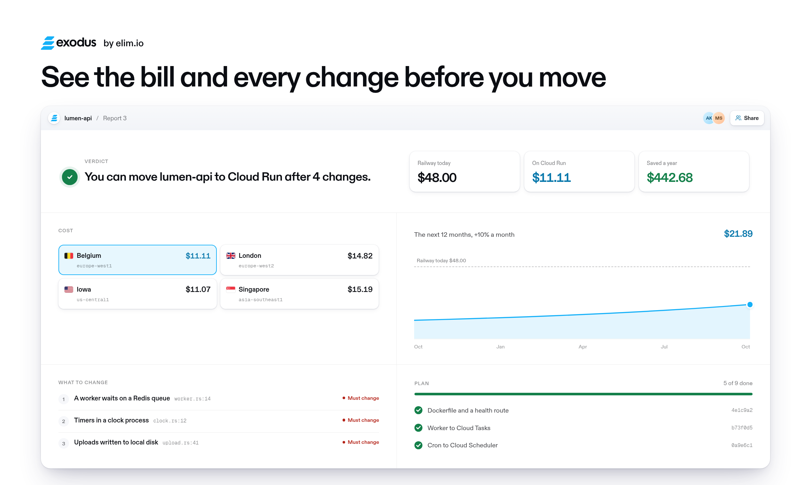
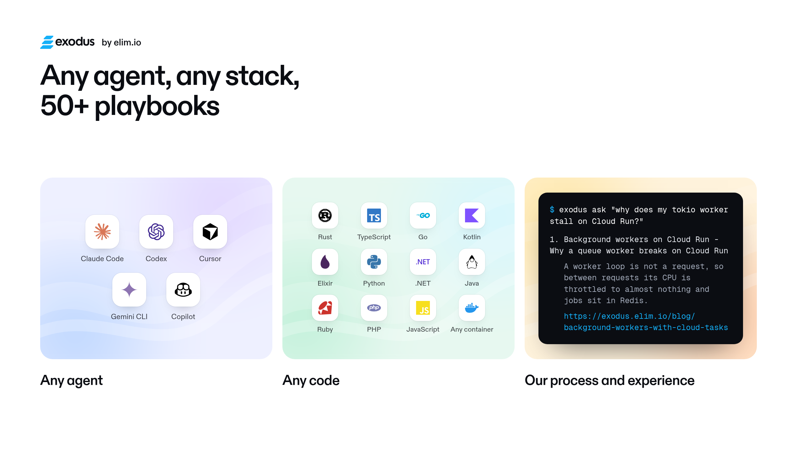
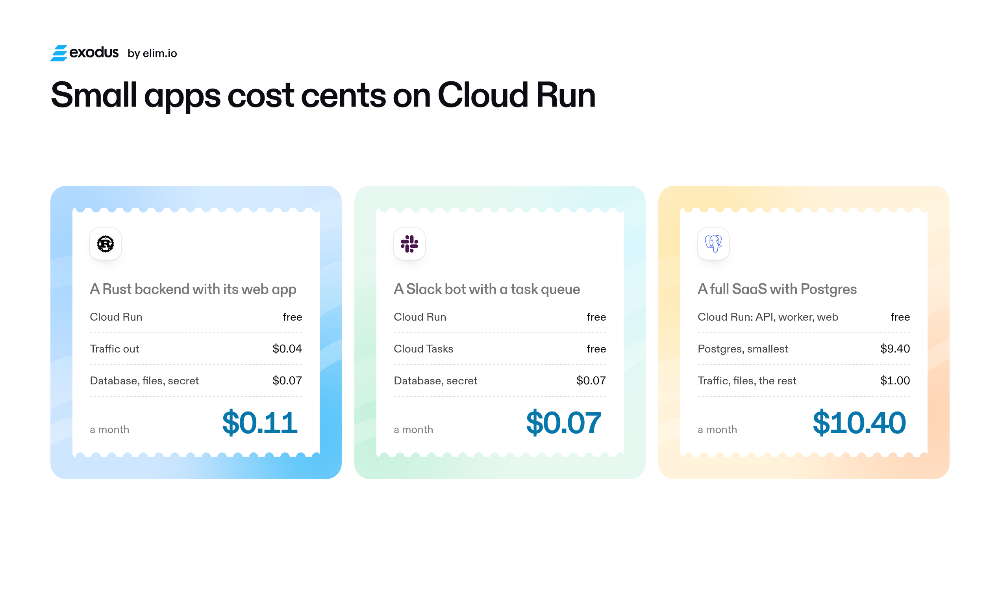
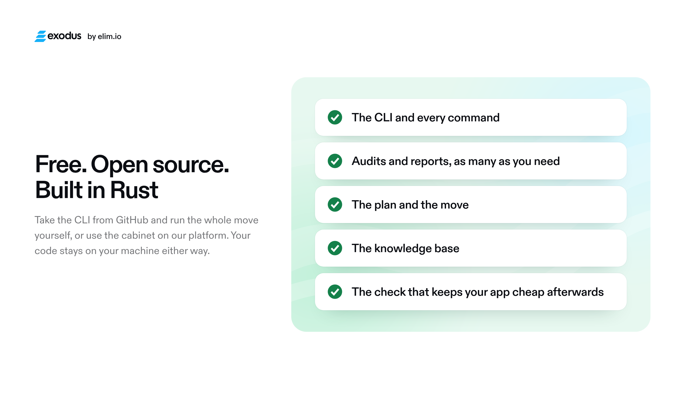

<p align="center">
  <picture>
    <source media="(prefers-color-scheme: dark)" srcset=".github/assets/cover-dark.png">
    
  </picture>
</p>

# exodus

[](https://github.com/elim-io/exodus/releases/latest)
[](https://github.com/elim-io/exodus/actions/workflows/ci.yml)
[](LICENSE)

<a href="https://www.producthunt.com/products/exodus-by-elim-io?launch=exodus-by-elim-io"></a>
[](https://www.producthunt.com/products/exodus-by-elim-io?launch=exodus-by-elim-io)

`exodus` is a command line for moving an app to Google Cloud Run with the coding agent you already use (Claude Code,
Codex, Cursor). It reads a repository, finds what will break on Cloud Run or keep billing while idle, prices the app on
its current platform and on Cloud Run, writes a report with the changes in order, and then keeps the plan while your
agent makes the changes one commit at a time.

Exodus runs no AI of its own. Your agent does the reading and the editing; `exodus` gives it a fixed procedure, a
scanner and a price model. Source code stays on your machine: the audit writes findings (what runs, what keeps data,
which lines break), never files. It reads the names of environment variables, never their values.

It is the open part of [Exodus](https://exodus.elim.io), "Stairway to Cloud Run". Everything here works without an
account. A free account adds a cabinet with the report and its history, sharing by link, the plan as a checklist, the
knowledge base from the command line, and checks from CI.

## What it looks like

<p align="center">
  
  
</p>
<p align="center">
  
  
</p>
<p align="center">
  
  
</p>
<p align="center">
  
  
</p>

## Install

```sh
curl -fsSL https://exodus.elim.io/install | sh
```

The script picks the binary for your machine from the [latest release](https://github.com/elim-io/exodus/releases/latest),
checks it against the release's `SHA256SUMS`, and puts it in `~/.local/bin`. Releases are built for Linux (x86_64 and
arm64, static), macOS (Intel and Apple silicon) and Windows (x64 and arm64).

- `sh -s -- --path` also adds `~/.local/bin` to `PATH` in your shell's rc file.
- `sh -s -- CODE` installs and then runs `exodus init --code CODE` in the current folder, which links it only when it is
  the top folder of a git repository (with `--new`, also an empty folder). Anywhere else, the home folder included, the
  code stays unused and the installer prints the command that spends it in the right folder.
- `EXODUS_VERSION=v0.2.4` installs a given release; `EXODUS_INSTALL_DIR=/some/bin` puts the binary elsewhere.

On Windows, in PowerShell:

```powershell
irm https://exodus.elim.io/install.ps1 | iex
```

It checks the binary the same way, puts it in `%LOCALAPPDATA%\Programs\exodus` and adds that folder to your user
`PATH` (no administrator rights). With a code from the cabinet,
`& ([scriptblock]::Create((irm https://exodus.elim.io/install.ps1))) -Code CODE` installs and then runs
`exodus init --code CODE` in the current folder (`-New` for an empty folder), under the same rules as above. The
credentials file is `%APPDATA%\exodus\credentials`.

From source, with Rust installed (edition 2024):

```sh
cargo install --locked --git https://github.com/elim-io/exodus exodus
```

A build from source reports version 0.0.0; the release binaries carry their tag's version.

## Quick start, offline

In the repository you want to move:

```sh
exodus init                # writes .exodus/ and the agent instructions
exodus audit               # reads the manifests and the code into .exodus/findings.json
exodus report              # builds .exodus/report.md and report.json here
exodus plan                # writes .exodus/plan.md, the tasks in order
```

Usually you do not type these. After `exodus init`, ask your agent to audit the repository "as the exodus instructions
say": it runs the audit, answers the audit's questions from the repository and the platform's command line, asks you
only what is left, builds the report and works the plan.

On the sample in `examples/node-railway` (Express, a BullMQ worker, a node-cron clock, uploads on disk, sessions in
memory) the audit prints:

```
platform: Railway (railway.json)
stack: Node 20, Express 4, BullMQ 5, PostgreSQL, Redis, railway.json
process web (web): node src/server.js [Procfile:1]
process worker (worker): node src/worker.js [Procfile:2]
process clock (cron): node src/clock.js [Procfile:3]
...
pattern in-process-timer (breaks): Timers inside the process [src/clock.js:9]
pattern memory-sessions (breaks): Sessions kept in process memory [src/server.js:14]
pattern local-disk-write (breaks): Files written to local disk [src/server.js:30]
pattern queue-worker (breaks): A worker waits on a Redis queue [src/worker.js:9]
```

and the report opens with:

```
You can move node-railway to Cloud Run after 4 changes.
Today $35.55 a month on Railway (estimated from its list prices), $10.02 on Cloud Run: saves $25.53 a month, $306.36 a year.
```

The prices are Google's published list prices, bundled and dated (`crates/exodus-cost/prices.json`), with the free
tiers applied; today's cost is the platform's list price for the plan and sizes the audit found, or your real bill
once the agent records it (`exodus answer bill`), part by part or as one total. The year's forecast grows the requests,
egress and the stored files with the visitors and keeps the rest (the database, schedules, builds) as it is; the report
names which lines grow.

## Offline, and with an account

| | without an account | with a linked account |
|---|---|---|
| `init`, `audit`, `answer`, `describe` | yes | yes; the audit also streams its progress to the cabinet |
| the report | `exodus report`, files in `.exodus/` | `exodus send` (the only command that uploads): kept in the cabinet with every version, shareable by link; `exodus report` still builds here and uploads nothing |
| the plan | `exodus plan` from the local report | the same, and the cabinet shows it as a checklist |
| `task done`, `need` | write `plan.md` | also tick the task or show the request in the cabinet |
| `check` | yes | with `EXODUS_KEY` in CI, each run is listed in the cabinet |
| `kb`, `ask` | no: the articles are public at https://exodus.elim.io/blog | the knowledge base from the command line |
| `bill` | reads and prints the month | also sends it, and the cabinet compares it with the estimate |

A command that needs an account says so and exits 2. To link one, sign in to the cabinet at https://app.exodus.elim.io,
copy the line with the code, and give it to your agent in the repository (or run `exodus init --code CODE` there
yourself). The code is spent only in the top folder of a git repository, or with `--new` in an empty folder; anywhere
else `exodus init` leaves it unused and prints the command for the right folder (`--here` links the folder anyway). The
cabinet's Google sign-in is not open yet; until it is, everything in the left column works without it. The code works
once, for 15 minutes; a used or expired code links nothing (exit 4), and a fresh line from the cabinet does. The key it
is exchanged for is kept in `~/.config/exodus/credentials` (mode 0600), never in the repository.

## Commands

| command | what it does |
|---|---|
| `exodus init [--code CODE] [--new] [--here] [--agent claude,codex,cursor]` | lays out `.exodus/` (git-ignored) and the agent instructions; `--code` links an account, in the top folder of a git repository only (or an empty folder with `--new`; `--here` links any folder), else it prints the command for the right folder and leaves the code unused; `--new` plans a product that is not built yet |
| `exodus audit [--json] [--offline]` | reads the manifests (Procfile, Dockerfile, `railway.json`, `render.yaml`, `fly.toml`, `app.json`, compose, `firebase.json`, `vercel.json`, `netlify.toml`, a Caddyfile or nginx config, a GitHub Pages workflow, the Dockerfiles of a monorepo's folders, the dependency files) and runs the pattern rules over the code that runs on the server; a match in browser code, build scripts and tools, a mobile or desktop app, tests or docs is listed as "not on the server" instead of a finding, and parts already on Google (Firebase Functions 2nd gen, Hosting, Firestore) as "stays as it is"; with no host named it asks the `platform` question |
| `exodus answer ID "TEXT" [--found HOW] [--value V]` | records an answer to one of the audit's questions; `--value` is what the report computes from (visitors a day, GB out, a region, the bill per part or as one total, the host's name, the MB a visit adds to egress and files for the forecast) |
| `exodus describe [--file PATH]` | writes what the agent understood from reading the code into `.exodus/findings.json`: three short paragraphs, `project:`, `today:` and `plan:`, on stdin or in a file (never on the command line, at most 16 KB, 1,200 characters a paragraph); the report opens with them as "Our understanding", and a new text makes the next version. Without it the report says the agent has not described the project and shows only the parts the audit found |
| `exodus report [--pull \| --report N] [--md \| --json]` | builds the report here from the findings and answers and uploads nothing, linked or not; `--pull` writes the platform's latest report into `.exodus/` instead, `--report N` version N |
| `exodus send [--agent NAME]` | uploads the findings and answers, pulls the new report back, prints its link; when the findings and answers are the ones the latest report was built from (whatever the agent, the CLI version or the time), that report stays the latest and nothing is stored |
| `exodus plan [--report N] [--force]` | writes `.exodus/plan.md` from a report, dated in your own time zone |
| `exodus task done N --commit SHA` | ticks task N with the commit that did it and today's date (your time zone) |
| `exodus need "TITLE" --task N --step "text\|command"` | asks the person for a step only they can do (sign in, billing, DNS); `--clear` withdraws it |
| `exodus check [--format github] [--fail-on breaks,idle] [--rules PATH]` | the audit's rules as a CI step: exits 1 on a finding of a failing kind |
| `exodus bill [--project ID] [--month YYYY-MM] [--dry-run]` | reads a month of the Google Cloud billing export with your own `gcloud` and `bq` |
| `exodus kb SLUG`, `exodus ask "QUESTION"` | reads an article of the knowledge base, or searches it |
| `exodus login --code CODE` | links an initialized repository again with a new code, for example after its key was revoked |
| `exodus status [--json]` | the project, the key's id, the reports and the plan's progress |
| `exodus key --ci` | mints a second key of the project for CI, printed once to a pipe |

`exodus <command> --help` has every flag.

## How the agent instructions work

`exodus init` writes the same procedure in three places, one per agent, so it can be committed with the repository:

- `.claude/skills/exodus/SKILL.md`, a Claude Code skill;
- an `## Exodus` section in `AGENTS.md` (created if absent; Codex and other agents read it), between
  `<!-- exodus:start -->` and `<!-- exodus:end -->`, so the rest of the file is left alone;
- `.cursor/rules/exodus.mdc`, a Cursor rule.

`--agent` picks which of them to write. Running `exodus init` again rewrites them with the current version's text.
The text is in `crates/exodus/templates/` (`move.md` for a move, `new.md` for a new product). It tells the agent to:

1. never run an installer itself: when `exodus` is missing (and not in `~/.local/bin`), ask the person to run the
   install line (in Claude Code, after `!`); when a code was used or ran out, ask the person for a fresh line from the
   cabinet instead of going on offline;
2. tell the person which files `exodus init` wrote and leave committing them to the person (no `git init`, no
   author of its own), then run `exodus audit` and read the code at the lines the scanner cannot decide on, changing
   nothing;
3. answer the audit's questions itself first, from the repository and the platform's read-only commands
   (`railway status`, `heroku ps`, `fly status` and the like), record each with `exodus answer ... --found`, and ask
   the person only what is left;
4. write what it understood from the code (what the product is, how it runs today, what the move changes) in three
   short paragraphs: to the person in their language, into the report in English with `exodus describe`;
5. build the report in the same turn, and tell the person the verdict and the two monthly totals;
6. work the plan one task at a time: change the code, add a test, commit only that task's files as the person's git
   identity, run `exodus task done N --commit SHA`;
7. stop and ask (`exodus need`) for anything only the person can do: signing in to Google Cloud, a billing account,
   DNS, IAM, anything that costs money.

The rules it gives the agent: source code never leaves the machine, secret values are never printed or put on a
command line, nothing that costs money or changes an account happens without the person's yes, and an answer names
no account, billing account or project id, because a report can be shared by link (`exodus answer` refuses a billing
account id). Exodus never signs
in to Google Cloud; whatever happens there is done with the person's own `gcloud`.

## In CI

`exodus check` runs the audit's rules and fails the build on a pattern that breaks on Cloud Run or bills while idle,
so they do not come back after the move. In GitHub Actions:

```yaml
- run: curl -fsSL https://exodus.elim.io/install | sh
- run: ~/.local/bin/exodus check --format github
  env:
    EXODUS_KEY: ${{ secrets.EXODUS_KEY }}   # optional: lists the run in the cabinet
```

`--format github` prints workflow annotations on the lines. `--rules PATH` adds your own rules (a file or a folder;
a rule with a built-in id replaces it). With a linked account, `exodus key --ci | gh secret set EXODUS_KEY` makes the
key; the check's exit code never depends on the platform being reachable.

## What is in this repository

| path | |
|---|---|
| `crates/exodus-schema` | the types of every file: findings, answers, report, plan |
| `crates/exodus-audit` | manifest readers, stack detection, the pattern scanner, the question bank (`questions.toml`); no network, no environment values |
| `crates/exodus-audit/rules` | the pattern rules as data, one TOML file per rule and language ([README](crates/exodus-audit/rules/README.md)) |
| `crates/exodus-cost` | Google's dated list prices and free tiers, the platforms' list prices, `price()` |
| `crates/exodus-report` | findings and answers into the report and its Markdown |
| `crates/exodus` | the `exodus` binary: commands, `.exodus/` files, credentials, the platform client, the agent templates |
| `examples/` | four made-up sample repositories (Railway, Heroku, Render, Fly.io) with the findings expected of each ([README](examples/README.md)) |
| `install.sh` | the installer the release ships (macOS, Linux) |
| `install.ps1` | the Windows installer the release ships |

Only the `exodus` binary talks to the network, and only to the platform's API (`https://app.exodus.elim.io`, or
`--api`) when an account is linked. The platform builds its reports with the same `exodus-cost` and `exodus-report`
crates, so a report built offline and one built in the cabinet from the same findings are the same. A call that
could not open a connection within 10 seconds is tried once more when it is a GET, PUT or DELETE (safe to repeat);
a POST is never repeated.

Behind a proxy, the binary takes it from the environment: the first of `ALL_PROXY`, `HTTPS_PROXY`,
`HTTP_PROXY` (or their lowercase forms) that is set, with hosts in `NO_PROXY` reached directly. `http://`, `socks5://`
(the name resolved here) and `socks5h://` (the proxy resolves it) work, with a user and password in the
URL if the proxy needs them. When a call through it fails, the error names the proxy by scheme, host and port, never the password.

## Contributing, security, license

- How to build, test and add a rule: [CONTRIBUTING.md](CONTRIBUTING.md).
- Reporting a vulnerability: [SECURITY.md](SECURITY.md).
- Licensed under the [Apache License 2.0](LICENSE).
